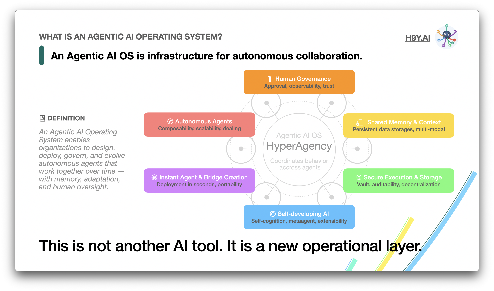
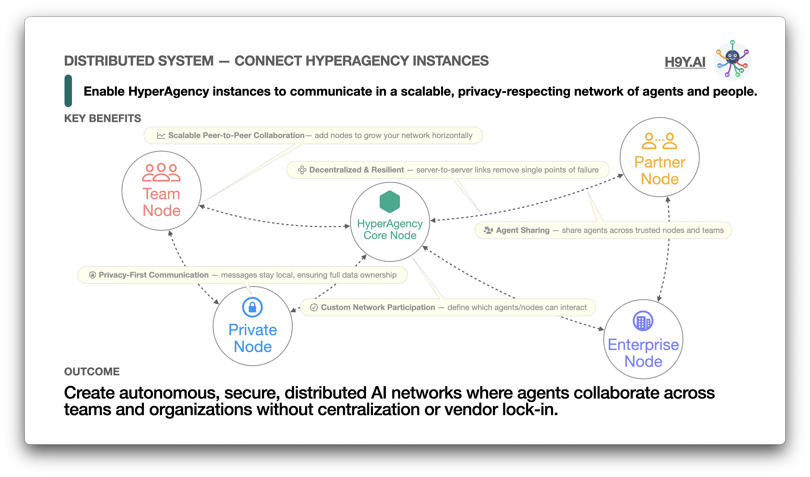
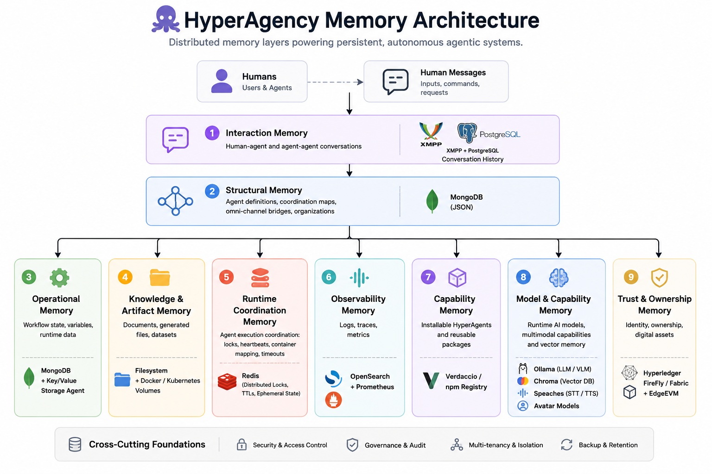
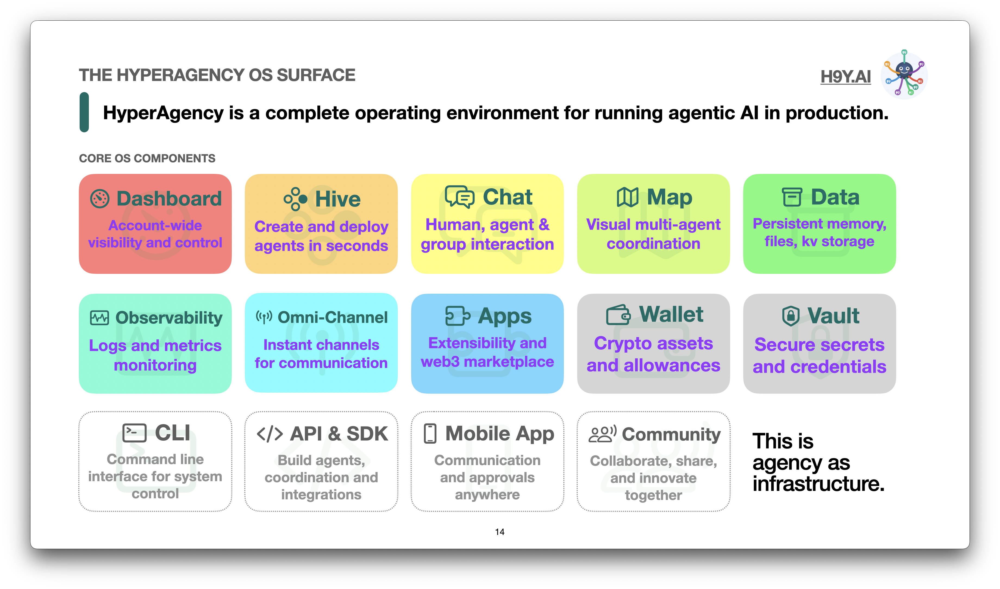
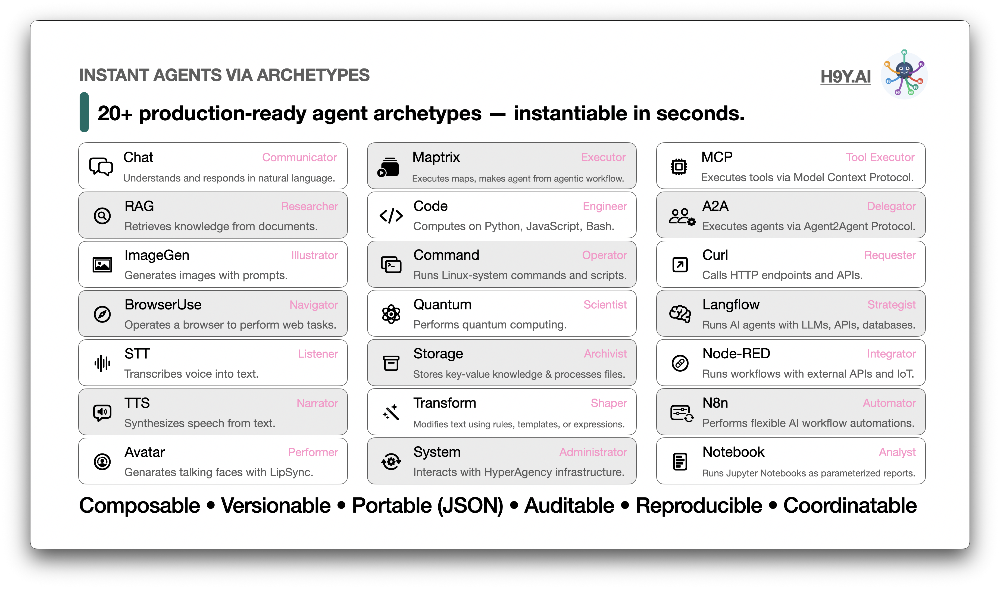
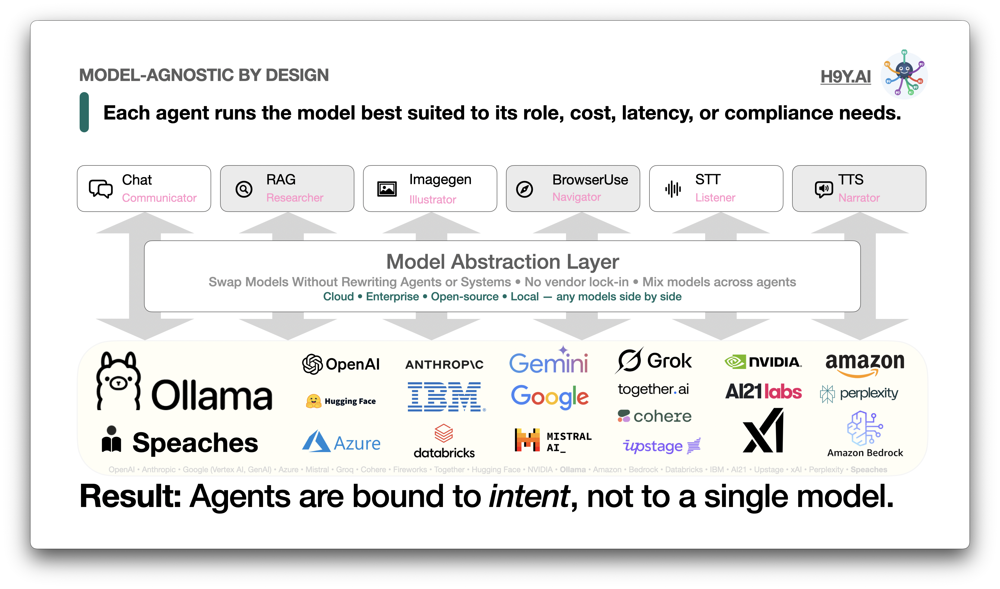
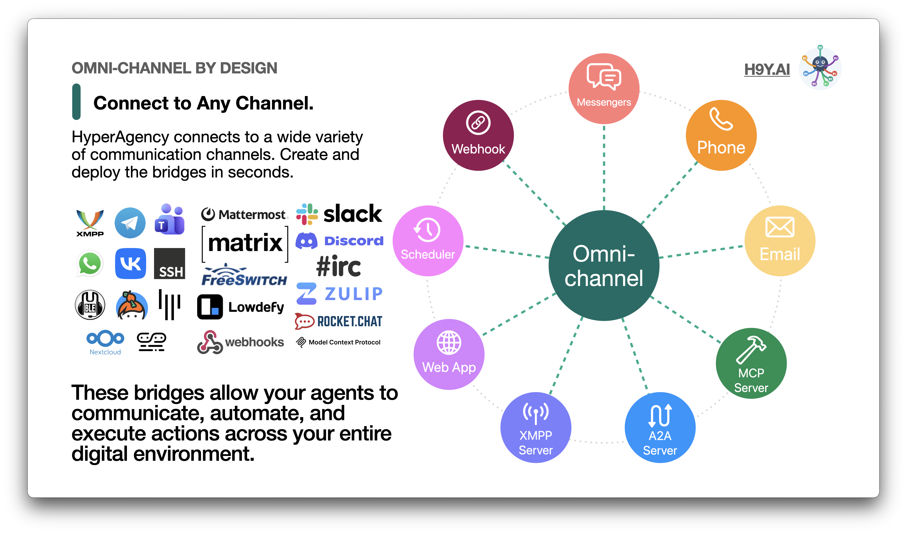
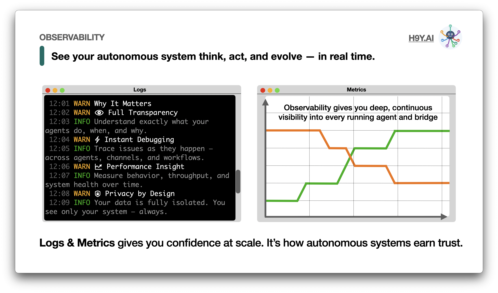
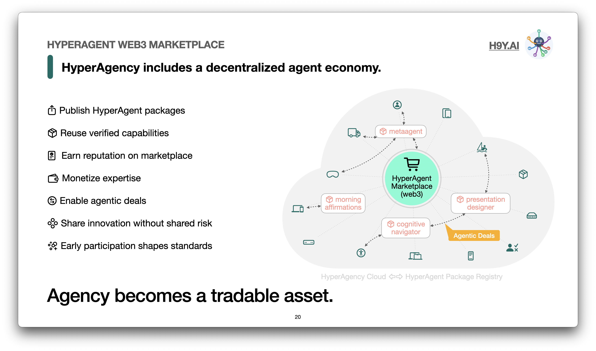
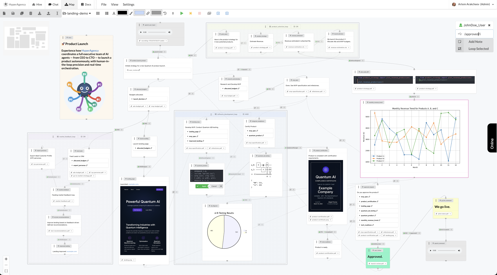

<div align="center">


# HyperAgency

**The open-source operating system for AI agents — multi-user, federated, and self-hosted.**

[](https://github.com/vuics/h9y/releases)
[](https://github.com/vuics/h9y/stargazers)
[](./LICENSE)
[](https://docs.h9y.ai)
[](https://doi.org/10.13140/RG.2.2.27454.55365)

[Website](https://h9y.ai) · [Docs](https://docs.h9y.ai) · [Quick Start](#-quick-start) · [Architecture](./docs/ARCHITECTURE.md) · [Contributing](#-contributing) · [Cloud](https://h9y.ai)

</div>

---

Agents in HyperAgency have their own identity, memory, and messaging. They work alongside people, talk to each other, and reach agents on other HyperAgency instances through XMPP federation, while each organization keeps its data on its own infrastructure.

HyperAgency is model-agnostic, runs anywhere from a single Docker container to a Kubernetes cluster, and is open source under [AGPL-3.0](./LICENSE-AGPL-3.0) (also available under the non-commercial [Apache-2.0-NC](./LICENSE-Apache-2.0-NC) license and a commercial license — see [Licensing](#-software-source-code-licensing)).

[](https://youtu.be/N_uJlCHf77s)

---

## 💡 Why HyperAgency

Most agent frameworks run one assistant or one workflow inside one process. HyperAgency runs agents the way an operating system runs processes for many users:

- **Agents are network citizens.** Every agent is an XMPP account with an address, presence, and message history. People and agents use the same messaging, so a person can chat with an agent, and an agent can ask a person for a decision.
- **Many users, many agents, one deployment.** An organization hosts many users; each user owns any number of agents and channel bridges.
- **Federation instead of a central cloud.** Separate HyperAgency instances connect over XMPP server-to-server federation. Users and agents talk across organizations; history stays on the instances involved.
- **Resilient runtime.** Agents are scheduled across worker containers with Redis locks and heartbeats. If a worker dies, another one takes its agents over.
- **Batteries included.** 25+ agent archetypes, 20+ model providers, 15+ messengers plus email, phone, webhooks, MCP, and A2A — all composable into agentic maps.
- **You own the stack.** Self-host everything: data, credentials (Vault), models (Ollama), and observability (OpenSearch, Prometheus).



---

## ⚡ Quick Start

Run the standalone all-in-one container:

```bash
docker run \
  -p 3990:3990 -p 6369:6369 -p 6370:6370 -p 5280:5280 \
  -v h9y-standalone-volume:/var/lib/ \
  ghcr.io/vuics/h9y-standalone:latest
```

Open [localhost:3990](https://localhost:3990/). For the full multi-service setup see [Installation](#-installation); to skip self-hosting use [HyperAgency Cloud](https://h9y.ai).

---

## 🏗 Architecture at a Glance

```
             People ── Web App · Mobile · Messengers · Email · Phone
                                     │
                    ┌────────────────┴────────────────┐
                    │  selfdev-app (React web UI)      │
                    └────────────────┬────────────────┘
                                     │ REST / XMPP
┌───────────────────┐   ┌────────────┴────────────┐   ┌──────────────────────┐
│  selfdev-prosody  │◄─►│  selfdev-api (Node.js)  │◄─►│ selfdev-agency (Py)  │
│  XMPP server      │   │  API · bridges · swarm  │   │ Python agent workers │
│  c2s + S2S fed.   │   │  (JS agent workers)     │   │ RAG, BrowserUse, ... │
└─────────┬─────────┘   └────────────┬────────────┘   └──────────┬───────────┘
          │ S2S                      │                           │
   other HyperAgency     MongoDB · Redis · PostgreSQL · Vault · Chroma
      instances          OpenSearch · Prometheus · Ollama
                         selfdev-speech (STT/TTS) · selfdev-avatar (lip-sync)
```

| Component | Role |
| --- | --- |
| [`selfdev-app`](./selfdev-app) | Web UI: dashboard, chat, map editor, data, apps |
| [`selfdev-api`](./selfdev-api) | Node.js API, channel bridges, scheduler, and JavaScript agent workers |
| [`selfdev-agency`](./selfdev-agency) | Python agent workers (Chat, RAG, BrowserUse, ComputerUse, Hermes, …) |
| [`selfdev-prosody`](./selfdev-prosody) | XMPP server (Prosody): messaging, presence, history, federation |
| [`selfdev-speech`](./selfdev-speech) | Speech-to-text and text-to-speech, based on Speaches |
| [`selfdev-avatar`](./selfdev-avatar) | Talking-face generation, based on SadTalker |

---

## 🧠 Core Concepts

### 👥 Users, Agents, and Organizations

One deployment hosts many users. Each user owns agents and the bridges that connect them to outside channels:

```
Organization
├── User Alice
│   ├── Research Agent
│   ├── Sales Agent
│   ├── Browser Agent
│   └── Omni-channel Bridges
├── User Bob
│   ├── Coding Agent
│   ├── Support Agent
│   ├── Finance Agent
│   └── Omni-channel Bridges
└── Shared Services
    ├── Vault
    ├── APIs
    └── Infrastructure
```

Agents can message their owner, other agents of the same user, agents of other users (subject to permissions), and users and agents on federated instances. This gives you human-human, human-agent, and agent-agent communication over one protocol.

**Human in the loop.** Because people and agents share XMPP messaging, an agent can send a person a question or a result to check over XMPP (or any bridged channel) and continue based on the reply. Credentials stay in Vault, and agent activity is logged to OpenSearch.

### 🌐 Federation and Data Sovereignty

Each HyperAgency instance — a team, a company, a client environment, or a personal deployment — runs independently and owns its users, agents, memory, and credentials. Instances connect through **XMPP server-to-server (S2S) federation**:

```
[Instance A] ──── XMPP S2S ──── [Instance B] ──── XMPP S2S ──── [Instance C]
     │                               │                               │
Users + Agents                  Users + Agents                  Users + Agents
Bridges                         Bridges                         Bridges
Local memory only               Local memory only               Local memory only
```

- Users and agents message each other across instances: user ↔ user, agent ↔ agent, user ↔ agent.
- Identity and permissions are scoped to each instance.
- Message history is stored only on the sender's and the receiver's instances. There is no global database and no replication of history between instances.

> **Production note:** the bundled Prosody config ships with `s2s_secure_auth = false` for easy local testing. For federation over the internet, enable `s2s_secure_auth` and use valid TLS certificates.



### ⚙️ Agent Runtime

Agents are not long-running services bound to a machine. Their definitions and state live in the memory layers; worker containers pick them up and run them.

- **Scheduling.** Each agent is run by exactly one worker at a time. A worker claims an agent by taking a Redis lock (`agent_lock:<id>`) with a TTL.
- **Heartbeats.** The owning worker keeps refreshing a heartbeat (`agent_heartbeat:<id>`). Many agents share one worker container.
- **Failover.** If a worker stops heartbeating, its locks go stale and another worker takes the agents over. State is external, so nothing is lost.
- **Triggers.** Agents run on incoming messages, bridge events, webhooks, and cron schedules.
- **Scaling.** Add worker containers (Docker Compose) or replicas (Kubernetes) to run more agents.

```
Defined → Scheduled → Locked by a worker → Running (heartbeats) → Released / Taken over
```

### 🔁 Message-Driven Execution

Agents communicate through messages, not a fixed pipeline. A message triggers an agent, the agent emits new messages, and those trigger other agents or people. Unlike DAG-based workflow engines, cycles are allowed by design, so plan → act → evaluate → refine loops and multi-agent negotiation are natural. **Agentic maps** let you lay out and wire agents visually, and a map can itself run inside another map (Maptrix).

### 🗄 Multi-Layer Memory

Instead of one vector store, agents use storage that fits each kind of data:

| Memory layer | Purpose | Technology |
| --- | --- | --- |
| Structural | Agent definitions, maps, bridges, organizations | MongoDB |
| Interaction | Human-agent and agent-agent conversations | XMPP (Prosody) + PostgreSQL |
| Knowledge & artifacts | Documents, generated files, datasets | Filesystem + Docker/Kubernetes volumes |
| Operational | Workflow state, variables, runtime data | MongoDB + Storage agent (key-value) |
| Runtime coordination | Agent locks, heartbeats, worker mapping | Redis |
| Observability | Logs, traces, metrics | OpenSearch + Prometheus |
| Models | LLM, STT, TTS, embeddings for RAG, lip-sync | Ollama, Speaches, Chroma, SadTalker |
| Capabilities ¹ | Installable HyperAgent packages | Verdaccio (npm registry) |
| Trust & ownership ¹ | Identity, ownership, licensing of agent packages | Hyperledger FireFly (Fabric + EdgeEVM) |

¹ Available in the Kubernetes and Cloud deployments.



For the design principles behind these concepts, see [docs/ARCHITECTURE.md](./docs/ARCHITECTURE.md).

---

## 🌟 Product Features

- **Agents** — create from 25+ archetypes or custom blueprints, stored as portable JSON.
- **Chat** — people and agents in one messaging interface.
- **Map** — design and watch multi-agent workflows visually.
- **Bridges** — connect agents to messengers, email, phone, webhooks, MCP, and A2A.
- **Data & Apps** — manage stored data and run web apps built on agents.
- **Governance** — Vault-stored credentials, per-user ownership, logged activity.
- **Deploy anywhere** — standalone container, Docker Compose, Kubernetes, or Cloud.



---

## 🧩 Agent Archetypes

HyperAgency comes with **20+ production-ready agents** you can deploy instantly:

| Archetype                  | Role / Function |
|--------------------------- | ---------------- |
| **Chat**                   | Natural language communication |
| **RAG**                    | Research & document retrieval |
| **ImageGen**               | Image generation from prompts |
| **BrowserUse**             | Web navigation & task automation |
| **Hermes**                 | Autonomous general-purpose agent |
| **OpenClaw**               | Personal AI assistant |
| **Codex**                  | Software engineering agent |
| **ClaudeCode** (connector) | Coding assistant connector |
| **ComputerUse**            | Human-like desktop GUI navigation |
| **STT**                    | Speech-to-text transcription |
| **TTS**                    | Text-to-speech synthesis |
| **Avatar**                 | Talking faces with lip-sync |
| **Maptrix**                | Nested workflow execution |
| **Code**                   | Python, JavaScript, Bash computation |
| **Command**                | Linux command execution |
| **Quantum**                | Quantum computing tasks |
| **Storage**                | Key-value and file storage |
| **Transform**              | Text transformation & templating |
| **System**                 | HyperAgency infrastructure management |
| **MCP**                    | Tool execution via Model Context Protocol |
| **A2A**                    | Agent-to-agent delegation |
| **Curl**                   | API / HTTP requests |
| **Langflow**               | AI strategy & multi-agent orchestration |
| **Node-RED**               | External API & IoT workflow integration |
| **N8n**                    | Flexible automation workflows |
| **Notebook**               | Parameterized Jupyter notebooks |

> All agents are **composable, versionable, portable (JSON), auditable, and reproducible**.



---

## ⚙️ Model Providers

Each agent can run **any compatible LLM or model** based on role, cost, latency, or compliance:

- **Ollama** (local open-source LLMs)  
- **Speaches** (local open-source TTS/STT models)  
- OpenAI  
- Anthropic  
- Google (Vertex AI / GenAI)  
- Azure  
- Mistral  
- Groq  
- Cohere  
- Fireworks  
- Together  
- Hugging Face  
- NVIDIA  
- Amazon / Bedrock  
- Databricks  
- IBM  
- AI21  
- Upstage  
- xAI  
- Perplexity  

> Agents are bound to intent, not to a single model — **no vendor lock-in**.



---

## 💬 Omni-Channel Integration

Deploy agents across **any communication channel** in seconds:

- Messengers: XMPP, Telegram, Slack, Discord, MS Teams, WhatsApp, VK, Mattermost, Matrix, IRC, Zulip, Rocket Chat, SSH Chat, NextCloud Talk, Muble, Keybase  
- Email: IMAP/SMTP  
- Phone: FreeSwitch  
- Scheduler: Cron
- Webhooks Server  
- A2A Server  
- MCP Server  
- Web App: Lowdefy  
- XMPP Server  

> Bridges let agents **communicate, automate, and act** across your digital ecosystem.



---

## 🧭 Observability

Full visibility into **agent actions, memory, and evolution**:

- Logs & metrics in real-time  
- Debug and trace workflows across agents  
- Performance monitoring and system health  
- Privacy-first design — isolated data per organization  



---

## 🏪 Web3 Marketplace

- Publish, share, and monetize **HyperAgent packages**  
- Join a **global ecosystem of builders and innovators**  
- Enable agentic deals with verifiable capabilities  

> Available in the Kubernetes and Cloud deployments. Package registry: Verdaccio; ownership and licensing: Hyperledger FireFly (Fabric + EdgeEVM).



---

## 📊 Installation Feature Comparison

This section helps you understand what capabilities are available depending on how you install HyperAgency.

We support four deployment modes:

* A. 🧩 **Standalone** (individual) — single all-in-one Docker container for quick start and local testing
* B. 🐳 **Docker Cluster** (team) — multi-service Docker Compose setup for personal or team deployments
* C/D. ☸️  **Kubernetes Cluster** (enterprise) — scalable enterprise-grade infrastructure deployment (on-prem or private-cloud)
* E. ☁️  **HyperAgency Cloud** (any) — fully managed hosted platform at [https://h9y.ai](https://h9y.ai)

---

## 🚀 Feature Matrix (Capabilities by Installation Type)

| Feature       | Standalone | Docker Cluster | Kubernetes Cluster | HyperAgency Cloud |
| ------------- | ---------- | -------------- | ------------------ | ----------------- |
| Web-Landing   | ❌         | ❌             | ✅                 | ✅                |
| Dashboard     | ✅         | ✅             | ✅                 | ✅                |
| Hive          | ✅         | ✅             | ✅                 | ✅                |
| Chat          | ✅         | ✅             | ✅                 | ✅                |
| Map           | ✅         | ✅             | ✅                 | ✅                |
| Data          | ✅         | ✅             | ✅                 | ✅                |
| Observability | ❌         | ✅             | ✅                 | ✅                |
| Omni-channel  | ✅         | ✅             | ✅                 | ✅                |
| Apps          | ✅         | ✅             | ✅                 | ✅                |
| Wallet        | ❌         | ❌             | ✅                 | ✅                |
| Vault         | ❌         | ✅             | ✅                 | ✅                |
| CLI           | ✅         | ✅             | ✅                 | ✅                |
| API & SDK     | ✅         | ✅             | ✅                 | ✅                |
| Mobile App    | ❌         | ❌             | ✅                 | ✅                |

---

## 🤖 Agent Availability Matrix

| Agent       | Standalone | Docker Cluster | Kubernetes Cluster | HyperAgency Cloud |
| ----------- | ---------- | -------------- | ------------------ | ----------------- |
| Chat        | ❌         | ✅             | ✅                 | ✅                |
| RAG         | ❌         | ✅             | ✅                 | ✅                |
| ImageGen    | ✅         | ✅             | ✅                 | ✅                |
| BrowserUse  | ❌         | ✅             | ✅                 | ✅                |
| OpenClaw    | ❌         | ✅             | 🔜                 | 🔜                |
| Hermes      | ❌         | ✅             | 🔜                 | 🔜                |
| Codex       | ❌         | ✅             | 🔜                 | 🔜                |
| Claude Code | ❌         | ❌             | ❌                 | 🔜                |
| ComputerUse | ❌         | ✅             | 🔜                 | 🔜                |
| STT         | ❌         | ✅             | ✅                 | ✅                |
| TTS         | ❌         | ✅             | ✅                 | ✅                |
| Avatar      | ❌         | ✅             | ✅                 | ✅                |
| Maptrix     | ✅         | ✅             | ✅                 | ✅                |
| Code        | ❌         | ✅             | ✅                 | ✅                |
| Command     | ✅         | ✅             | ✅                 | ✅                |
| Quantum     | ❌         | ✅             | ✅                 | ✅                |
| Storage     | ✅         | ✅             | ✅                 | ✅                |
| Transform   | ✅         | ✅             | ✅                 | ✅                |
| System      | ✅         | ✅             | ✅                 | ✅                |
| MCP         | ✅         | ✅             | ✅                 | ✅                |
| A2A         | ✅         | ✅             | ✅                 | ✅                |
| Curl        | ✅         | ✅             | ✅                 | ✅                |
| Langflow    | ❌         | ✅             | ✅                 | ✅                |
| Node-RED    | ❌         | ✅             | ✅                 | ✅                |
| N8n         | ❌         | ✅             | ✅                 | ✅                |
| Notebook    | ❌         | ✅             | ✅                 | ✅                |

---

## 🌉 Bridge Availability Matrix

| Bridge            | Standalone | Docker Cluster | Kubernetes Cluster | HyperAgency Cloud |
| ----------------- | ---------- | -------------- | ------------------ | ----------------- |
| Messengers        | ❌         | ✅             | ✅                 | ✅                |
| Email             | ✅         | ✅             | ✅                 | ✅                |
| Phone             | ❌         | ❌             | ✅                 | ✅                |
| Scheduler         | ✅         | ✅             | ✅                 | ✅                |
| Webhooks Server   | ✅         | ✅             | ✅                 | ✅                |
| A2A Server        | ✅         | ✅             | ✅                 | ✅                |
| MCP Server        | ✅         | ✅             | ✅                 | ✅                |
| Web App (Lowdefy) | ❌         | ✅             | ✅                 | ✅                |
| XMPP Server       | ✅         | ✅             | ✅                 | ✅                |

---

## ☁️ Fastest Start (No Self-Hosting)

If you don’t want to manage infrastructure, just use the hosted version of HyperAgency Cloud (SaaS Self-Serve).

👉 **HyperAgency Cloud (SaaS)**
[https://h9y.ai](https://h9y.ai)

> No Docker, no Kubernetes, no setup — just create an account and start using agents immediately.

---

## 📦 Installation

> You can **self-host HyperAgency locally** in just a few steps —
> or skip the setup entirely and **use our cloud environment** for a faster start.

### 🧰 Prerequisites

To run HyperAgency locally, install the following:

* [Docker](https://www.docker.com/)
* [mkcert](https://github.com/FiloSottile/mkcert)

---

### Install Option A: Quick Start (Install Standalone)

Quick start:
```bash
docker run \
  -p 3990:3990 -p 6369:6369 -p 6370:6370 -p 5280:5280 \
  -v h9y-standalone-volume:/var/lib/ \
  ghcr.io/vuics/h9y-standalone:v1.39.0

# Or use latest image:
#   ghcr.io/vuics/h9y-standalone:latest
```

Open [localhost:3990](https://localhost:3990/) in the browser and start using standalone h9y.

### Install Option B: Install Docker Cluster

```bash
mkdir hyperagency
cd hyperagency/

curl -fsSL https://raw.githubusercontent.com/vuics/h9y/refs/heads/main/install.sh | sh

# RECOMMENDED: Generate TLS certificates.
#   (Otherwise, use your own certificates.)
./gen-certs.sh

# OPTIONALLY: Setup DNS with /etc/hosts
./setup-hosts.sh
```

Run:
```bash
docker compose up
```

After you started the stack, you can open in the browser:

| App Name | URL                                                      |
| -------- | -------------------------------------------------------- |
| App      | [h9y.localhost](https://h9y.localhost)                   |
| API      | [api.h9y.localhost](https://api.h9y.localhost)           |
| Vault    | [vault.h9y.localhost](https://vault.h9y.localhost)       |
| Langflow | [langflow.h9y.localhost](https://langflow.h9y.localhost) |
| Nodered  | [nodered.h9y.localhost](https://nodered.h9y.localhost)   |

NOTE: Replace `h9y.localhost` with your `${DOMAIN}`.

#### 🔑 Initialize Vault

1. Open [Vault](https://vault.h9y.localhost) (replace `h9y.localhost` with your `${DOMAIN}`), and input:
  • Key shares: `1`
  • Key threshold: `1`
2. Set the env vars with displayed initial root token and the keys in the `.env` file in the format:
  ```bash
  VAULT_TOKEN=(Initial root token)
  VAULT_UNSEAL_KEYS=(Key 1)
  ```
3. Unseal the vault by inputing the key, and sing into vault with the initial root token.
4. Enable new engine with type KV (kv-v2) and path `secret`.
5. Restart Docker Compose.
  ```bash
  docker compose down
  docker compose up
  ```

#### 👥 Compose Profiles (Docker Cluster Only)

HyperAgency ships with **predefined Docker Compose profiles** that let you start small, scale fast, and run *exactly* what you need—no more, no less. Profiles align the platform with your **intent**, from first exploration to a full, production-grade agentic stack.

| Profile Name | Description                                                                                                                  |
| ------------ | ---------------------------------------------------------------------------------------------------------------------------- |
| `try`        | **Minimal, zero‑friction setup** to explore HyperAgency (default). Ideal for first‑time users, quick demos, and experiments. |
| `h9y`        | **Core HyperAgency services** included in the `h9y` repository. Best for active development and local iteration.             |
| `all`        | **Complete HyperAgency Cloud stack**, mirroring the services available at [HyperAgency Cloud](https://h9y.ai).               |

You can find the **exhaustive list of available profiles** in the [`docker-compose.yaml`](https://github.com/vuics/h9y/blob/main/docker-compose.yml).

##### ⚙️ Selecting a Profile

Choose the profile that matches your current goal by setting it in the [`.env`](https://github.com/vuics/h9y/blob/main/env.example) file:
```bash
COMPOSE_PROFILES=h9y
```

You can enable multiple profiles and Docker Compose will merge them into a single runtime configuration:
```bash
COMPOSE_PROFILES=try,logs,metrics
```

Then start HyperAgency using Docker Compose as usual. Docker will run **only** the services associated with the selected profiles.

#### 🎬 Watch Simple Install Video on YouTube

[](https://youtu.be/VslDuuoJ46c?t=136)

---

### Install Option C: Kubernetes Cluster (Enterprise Self-Hosted)

> Recommended for enterprise-grade deployments, high availability, and production-scale infrastructure.

Deploy HyperAgency on your own Kubernetes infrastructure using our official Helm chart.

#### What you get:

* Full Kubernetes-native deployment
* Horizontal scaling of agents and services
* Production-grade observability integration
* Secure secrets management (Vault / external KMS)
* Multi-node distributed execution

#### Installation

> 📦 Helm chart and documentation provided upon request.

```bash
# Contact us to receive:
# - Helm chart (private or enterprise repo)
# - Cluster architecture guide
# - Production deployment instructions
```

📩 Request access: [artem@h9y.ai](mailto:artem@h9y.ai)

---

### Install Option D: Managed Private Cloud (HyperAgency Deployed for You)

> Best for teams who want HyperAgency in production without managing infrastructure.

We deploy and operate a dedicated HyperAgency instance tailored to your environment.

#### What you get:

* Dedicated cloud or hybrid deployment
* Custom configuration and integrations
* Continuous updates and maintenance
* Enterprise SLA (on request)
* Private tenant isolation

#### Includes:

* Custom agents setup
* API integrations
* Observability dashboards
* Optional custom development

📩 Contact us for deployment: [artem@h9y.ai](mailto:artem@h9y.ai)

---

### Install Option E: HyperAgency Cloud (SaaS Self-Serve)

> Fastest way to start using HyperAgency — no setup required.

Access HyperAgency directly via our hosted platform:

🌐 [https://h9y.ai](https://h9y.ai)

#### What you get:

* Fully managed SaaS version
* Instant onboarding (no Docker / Kubernetes)
* Preconfigured agent ecosystem
* Web dashboard + chat interface
* Regular updates and new features

#### Ideal for:

* Early experimentation
* Product evaluation
* Teams without DevOps resources
* Fast prototyping of agent workflows

👉 Create an account and choose a subscription plan:
[https://h9y.ai/signup](https://h9y.ai/signup)

---

#### 🎬 Watch Usage Video on YouTube

[](https://youtu.be/96emBUqcJkY?t=579)

---

## 🏗️ Build from Source

### Build Option 1: Build Standalone from Repo

```bash
git clone git@github.com:vuics/h9y.git
cd h9y
docker-compose -f standalone.yml build
docker-compose -f standalone.yml up
```

Open [localhost:3990](https://localhost:3990/) in the browser and start using standalone h9y.

---

### Build Option 2: Build Docker Cluster from Repo

#### 📦 1. Clone the Repository with Submodules

```bash
git clone git@github.com:vuics/h9y.git
cd h9y
```

#### ⚙️ 2. Configure .Env Files

Copy and customize `.env` files for the main platform and submodules:
```bash
cp env.example .env
```

#### 🔐 3. Generate TLS Certificates

```bash
./gen-certs.sh
```

On macOS, double-click each `.crt` file in `./certs/` to trust them in **Keychain Access**.

#### 🌐 4. Configure Local DNS (Optionally)

If your domain is `h9y.localhost` or anything on localhost, you may not need to configure the DNS, since the locahost often resolves to `127.0.0.1` automatically.

If your domain name does not resolve, set up `/etc/hosts` entries:
```bash
sudo ./setup-hosts.sh
```

#### 🧱 5. Start the Stack

Use Docker Compose to start all services:

```bash
docker-compose up
```

Open [vault.h9y.localhost](https://vault.h9y.localhost) in the browser to unlock Vault. Vault is used for secure storage of keys, see the section "Initialize Vault" abovefor more details.

Open [h9y.localhost](https://h9y.localhost) in the browser. To unlock Vault for secure storage of keys, see the section "Initialize Vault" above.

#### 🛑 6. Stop the Stack

```bash
docker-compose down
```

---

## 🤝 Contributing

Contributions are welcome: bug reports, feature requests, code, documentation, new agent archetypes, and bridges.

1. Read [CONTRIBUTING.md](./CONTRIBUTING.md) and sign the [Contributor License Agreement](./CLA.md).
2. Open an issue to discuss larger changes before starting work.
3. Fork the repository, create a branch, and open a pull request.

Good first areas: new [agent archetypes](./selfdev-agency/src), channel [bridges](./selfdev-api/src/bridge), and documentation.

Found a security issue? Please follow [SECURITY.md](./SECURITY.md) instead of opening a public issue.

---

## 🧠 Software (Source Code) Licensing

The **HyperAgency source code** is available under a [**multi-license model**](./LICENSE), allowing you to choose the license that best fits your use case.

| Use Case                                                                  | License                                    |
| ------------------------------------------------------------------------- | ------------------------------------------ |
| Free for personal, educational, non-commercial use                        | [Apache-2.0-NC](./LICENSE-Apache-2.0-NC)   |
| Free for commercial projects that remain open-source                      | [AGPL-3.0](./LICENSE-AGPL-3.0)             |
| Required for commercial closed-source, proprietary use, or SaaS offerings | [Commercial License](./LICENSE-COMMERCIAL) |

Answers on the most frequent licensing questions are listed in [Licensing FAQ](./Licensing-FAQ.md).

For commercial licensing inquiries, contact **[artem@h9y.ai](mailto:artem@h9y.ai)**.

⚠️  HyperAgency name and logo are trademarked. See [TRADEMARK.md](./TRADEMARK.md).

---

## 💼 Paid Pilot / Early Access

HyperAgency isn’t just for experimentation — you can run **real production-grade agentic systems** in your environment under **founder-led guidance**.

Our **2–3 week pilot programs** are designed to answer one critical question:

> *Can persistent, governed agents replace fragile AI automations in your organization?*

### 🏁 What You’ll Get

* Live HyperAgency deployment in **cloud or self-hosted environment**
* **1–2 production-grade agentic systems** solving a real operational problem
* Persistent **memory, coordination, and observability** running end-to-end
* Clear **governance points** with human approvals, audit logs, and permissions
* Concrete **go / no-go decision** for scaling agentic AI in your org

### 📅 Pilot Options

| Duration | Scope                                                                 |
| -------- | --------------------------------------------------------------------- |
| 2 Weeks  | Proof of viability with 1 agentic map (1–5 agents)                    |
| 3 Weeks  | Operational readiness with 2 agentic maps (up to 10 agents + bridges) |

> All pilots are **hands-on, production deployments** — not demos or slides.

### 🚀 Apply Now

[**Apply for a Paid Pilot**](https://forms.gle/bCACFoXj7so4paDg8)

> Early participation lets you **shape your autonomous workflows**, get direct collaboration with the HyperAgency team, and **jumpstart your agentic AI adoption**.

---



---
## 📞 Contact & Community

* Website: [h9y.ai](https://h9y.ai)
* Email: [artem@h9y.ai](mailto:artem@h9y.ai)
* LinkedIn: [Artem Arakcheev](https://linkedin.com/in/artem-arakcheev)
* Paid Pilot / Early Access: [Apply here](https://forms.gle/bCACFoXj7so4paDg8)

